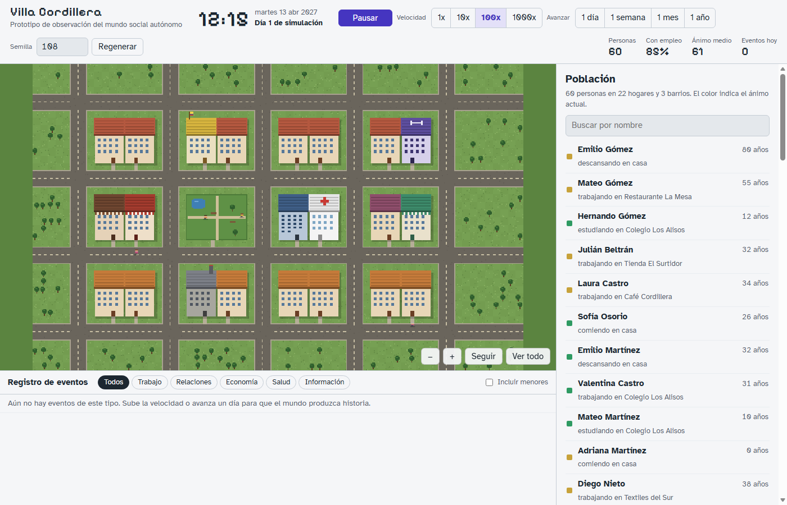
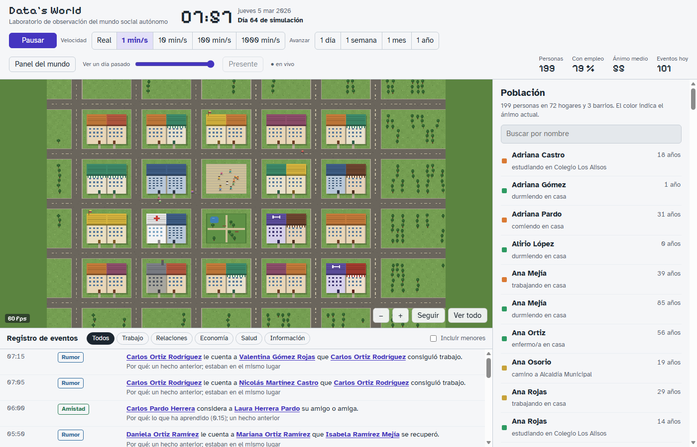
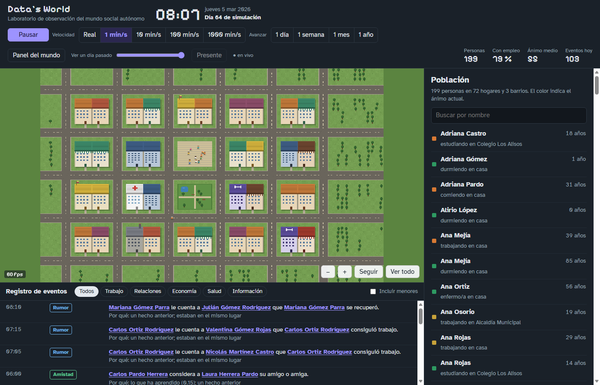
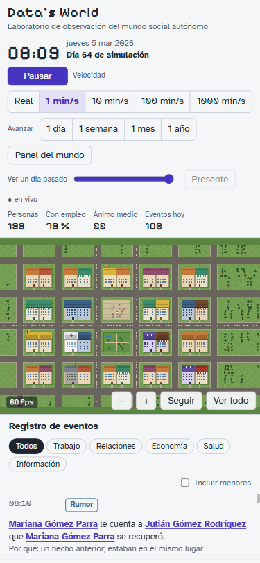
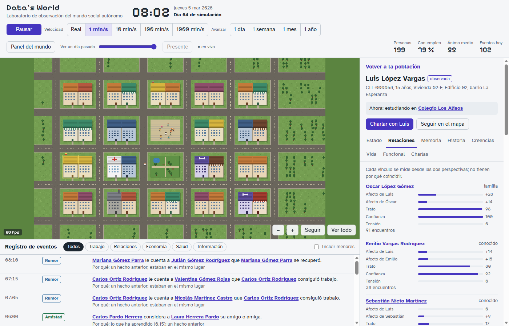
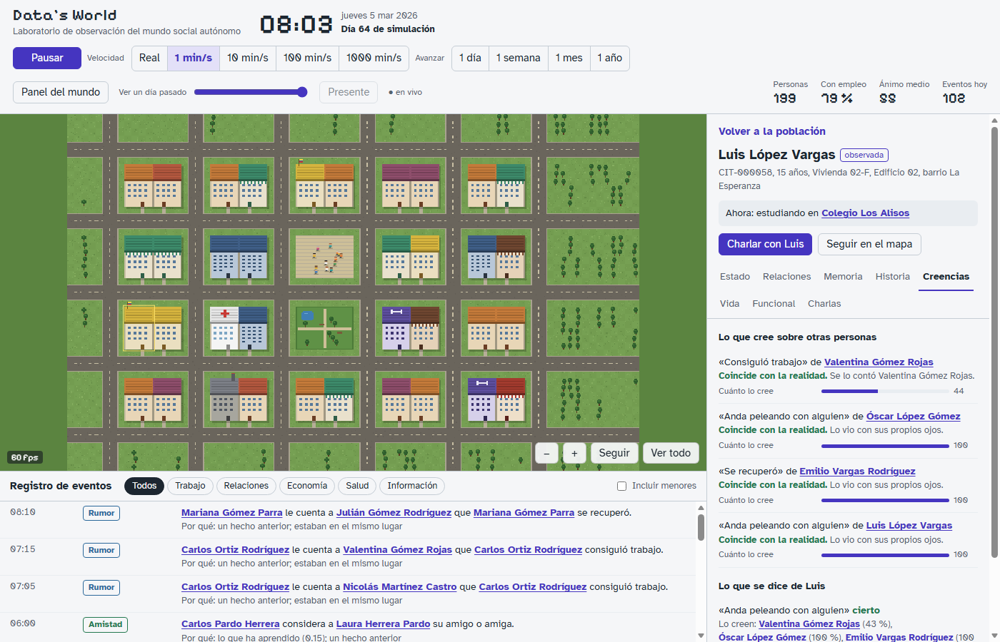
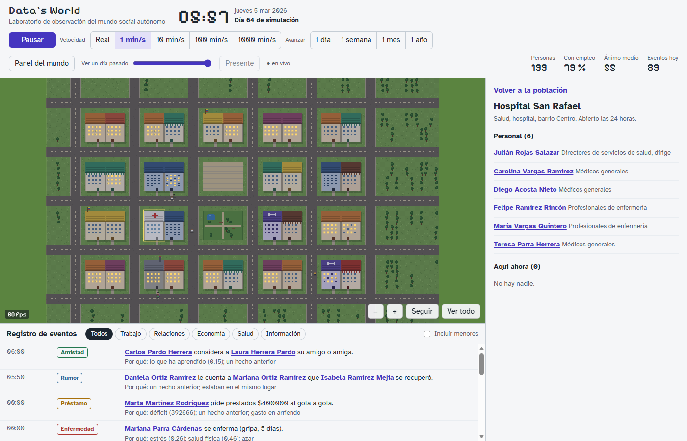
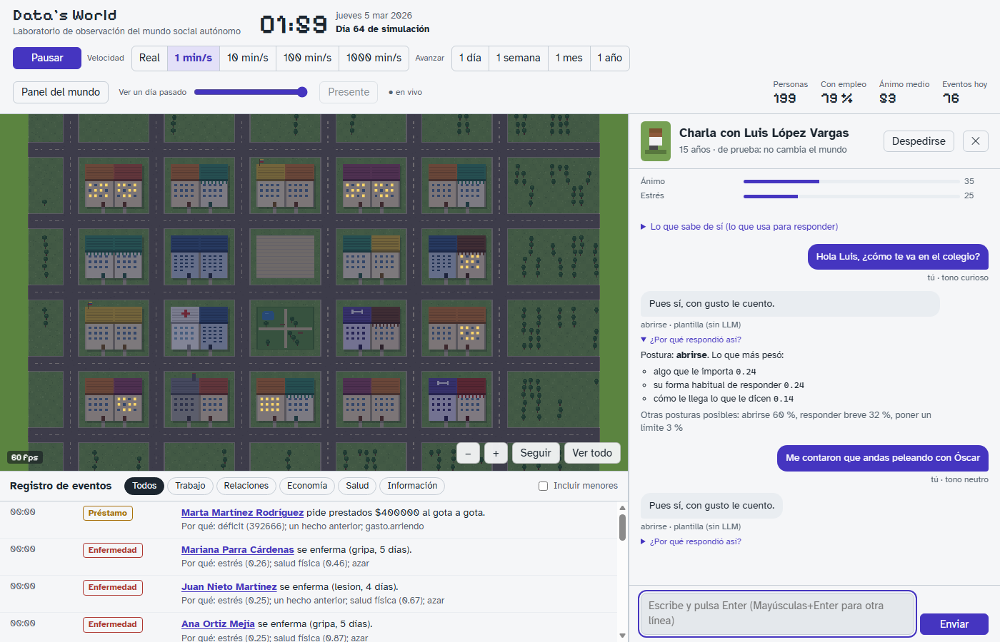

# M4 — Paridad del visor con el prototipo

Fecha: 2026-09-29 · Rama `m4/observacion` · Specs 024 v0.4, 022 v0.4 y 027 v0.5 (P1 a P6, aprobados por el usuario tras su revisión: «no se parece en nada al prototipo; las personas quedan en círculos frente a los edificios»).

## Qué fallaba y por qué

| Síntoma | Causa | Arreglo |
|---|---|---|
| Personas en corro frente a los edificios | El visor dibujaba a todos en la puerta de su lugar | Como el prototipo, solo se dibuja a quien camina o está al aire libre; de noche se encienden las ventanas con gente (024 R-013) |
| Nadie camina | El worker guardaba una vez por hora del mundo y el motor no anota los paseos dentro del pueblo: entre dos guardados, un paseo de 5 min no dejaba rastro | El worker anota cada viaje tick a tick (027 R-013) y guarda también cada 2 s reales (R-014); el visor reproduce cada trayecto a su hora con un reloj de vista (024 R-013) |
| Otra disposición | El visor mínimo no seguía el prototipo | Barra superior, mapa ajustado, registro bajo el mapa e inspector, con los colores y las fuentes del prototipo (024 R-014 a R-016) |
| Pestañas vacías | El mundo local era de M2 (sin relaciones, memoria ni rumores) | Mundo de demostración nuevo (P5) |
| Lista de población vacía al abrir | Se pintaba con la primera actualización | Se pinta al cargar |
| La ficha tardaba 1,8 s y la charla 3,4 s en abrir | Leer los participantes de un evento recorría la tabla entera (sin índice por evento) | Migración 005 con ese índice: la ficha tarda 13 ms, el informe de vida 23 ms y abrir la charla 170 ms |
| La charla se quedaba «abriendo» | La API respondía 401 con `WWW-Authenticate` y el navegador abría su propia ventana de acceso | Sin esa cabecera: pide las credenciales el formulario del visor |

## Capturas (prototipo y visor)

| Prototipo | Visor |
|---|---|
|  |  |

| Oscuro | Móvil (375 px) |
|---|---|
|  |  |

| Relaciones (dos perspectivas) | Creencias (y lo que se dice de la persona) |
|---|---|
|  |  |

| Ficha de un lugar | Charla (sandbox, sin clave del modelo) |
|---|---|
|  |  |

Las capturas se tomaron con Edge sin ventana sobre el mundo de demostración (`data/world.db`, semilla 482917, 199 personas, 64 días) a 1400 × 900.

## Criterios

| Criterio | Cómo se comprueba | Resultado |
|---|---|---|
| 027 CA-009 | `apps/worker/src/moves.test.ts`: cada viaje de un día aparece una vez, sin solaparse, y el `stateHash` es el de avanzar sin anotarlos | verde |
| 027 CA-010 | `moves.test.ts`: `advance` de 1 día llega al minuto exacto, muestra el progreso y respeta la velocidad; una pausa lo interrumpe | verde |
| 022 CA-009 a CA-011 | `apps/api/src/observe.test.ts`: movimientos, indicadores, `advance` no admitido (400), `aboutMe` y personal del lugar | verde |
| 024 CA-009, CA-010 | `apps/web/src/replay.test.ts`: posición antes, durante y después de un viaje; quién se dibuja; ventanas; reloj de vista | verde |
| 024 CA-011 | `apps/web/src/log.test.ts`: categorías, menores, nombres pulsables y porqué legible | verde |
| 024 CA-012 | `apps/web/src/card.test.ts`: las ocho pestañas con una ficha de ejemplo | verde |
| 024 CA-013 | Capturas lado a lado (arriba) y revisión del usuario | **pendiente de la revisión del usuario** |

Prueba de punta a punta en el navegador:
- el reloj avanza sin saltos atrás;
- avanzar 1 día muestra «Simulando sin observar»;
- funcionan el tooltip, «Seguir», la línea temporal y el panel del mundo;
- la charla sandbox pasa por el acceso, dos mensajes, el porqué y el resumen.

## Medidas

- **Fotogramas:** 60 fps con 199 personas.
- **Memoria:** el worker ocupa 103 MB y la API 292 MB (estable; es basura aún sin recoger, no una fuga). Vite ocupa 105 MB, pero solo en desarrollo. Cabe en el servidor de 1 GB.
- **Tiempos de la API**, antes y después del índice:

  | Ruta | Antes | Después |
  |---|---|---|
  | Ficha | 1,8 s | 13 ms |
  | Informe de vida | 1,7 s | 23 ms |
  | Vida | 53 ms | 14 ms |
  | Abrir charla | 3,4 s | 170 ms |

- **Gente caminando.** Se calculó con el código de escena del visor sobre los viajes reales de 2 días: de media, 0,36 personas en la calle a la vez; como máximo, 32 (en la hora punta). Los viajes duran 3,4 min de media.

## Pendiente: dos diferencias de fondo con el prototipo (del motor, no del visor)

El visor ya dibuja cada trayecto que el motor simula, pero el prototipo tiene más gente en la calle por dos razones de modelo. Cambiarlas toca specs del motor (003, 016, 011/017), así que queda para decisión del usuario.

1. **Escala del mapa:**
   - nuestro tile mide 8 m, así que el pueblo tiene 640 × 400 m y un trayecto a pie dura unos 3 min;
   - en el prototipo, un tile son 0,6 min a pie (≈ 45 m): el pueblo tiene unos 3 × 2 km y los trayectos duran de 12 a 24 min;
   - con la escala del prototipo, los viajes durarían unas 5,6 veces más y en la calle habría esa proporción más de gente.
2. **Viajes por persona:**
   - unos 0,7 viajes por persona y día (mucho ocio en casa);
   - en el prototipo, cada persona va y viene varias veces al día (trabajo, comida, amigos, compras, parque).
