# M4 — Visor A+: paridad con el lienzo aprobado

Fecha: 2026-09-30 · Rama `claude/busy-mayer-fj6x13` · Specs 024 v0.5 y 022 v0.5 (aprobadas por el usuario el 2026-09-30).

Referencia: el lienzo «Datas World — Visor A+» (https://claude.ai/artifact/L27kh8DDNoNa5R9uimn97B), con cuatro pantallas: *Mundo · mapa y ficha*, *Ficha ampliada · expediente de vida*, *Dashboard · información del mundo* y *Charla con un ciudadano*. El usuario indicó que la v0.4 no tenía ni el expediente ni el dashboard, y que el prototipo HTML ya había cumplido su función.

Las capturas son del mundo de ejemplo `docs/validaciones/mundos/m2-482917.db` (199 personas, el mismo que dibuja el lienzo), en Chromium sin conexión a Google Fonts: en local, con las fuentes IBM Plex cargadas, el texto se ve como en el lienzo.

## Pantalla por pantalla

| Lienzo | Visor | Diferencias |
|---|---|---|
| Menú lateral oscuro: Mundo, Datos; Estudio y Muestra bloqueados | Igual, con los mismos iconos y el aviso de la capa de investigación. Botón de tema claro u oscuro al pie | En móvil, el menú pasa abajo |
| **Mundo:** cabecera con fecha y hora, «Simulando», velocidades y «+1 día»; personas, hogares y organizaciones | Igual. Las velocidades son las del motor (002), en minutos por segundo; «Avanzar…» añade semana, mes y año | El lienzo rotula 1×, 10× y 60× |
| Capas: Personas, Lugares, Objetos, Vínculos, Ánimo, Día/noche | Las seis capas. Objetos aparece bloqueada: los objetos aún no tienen posición en el mapa (005) | — |
| Panel «Ahora»; escala «50 m»; + y − | Igual, con los recuentos de la API (022 R-016). La escala cambia con el zoom | El visor añade «Seguir» y «Ver todo» |
| Etiqueta sobre la persona elegida | «CIT-000019 · Santiago Osorio · lo que hace» | — |
| Registro en tabla: Hora, Tipo, Qué pasó, Causas; filtro y «Abrir línea de tiempo» | Igual; «Incluir menores» y la línea de tiempo se despliegan bajo la cabecera | — |
| Ficha compacta: Ampliar expediente, Charlar; actividad, lugar, hogar, dinero; estado; «Por qué está aquí» | Igual, con el aviso de necesidad crítica y el enlace «Ver historia, vínculos, aprendizaje y salud →» | — |
| **Expediente:** migas, Exportar JSON, Charlar, Reducir; franja de identidad con Ahora, Ánimo, Estrés y Alertas | Igual | — |
| Pestañas: Resumen, Estado y necesidades, Emociones, Historia, Vínculos, Aprendizaje, Salud, Economía y objetos, Charlas | Las nueve, más Memoria y Creencias tras Vínculos (decisión del usuario) | — |
| Resumen: identidad, por qué, curso de vida con los tramos «en el campo» / «en Data's World» | Igual; los hitos salen de la historia de origen (030) y de la simulación | — |
| Estado: necesidades (1 = satisfecha) con la crítica explicada; agenda de hoy en 24 h | Igual; la agenda es la rutina prevista (011) con los viajes del día | — |
| Historia: tabla con filtro Todos / Historia de origen / Simulación | Igual, con «¿por qué?» y el informe de vida completo debajo | — |
| Vínculos: familia en tabla y red relacional | Igual, con el familiograma y los vínculos desde las dos perspectivas | — |
| Aprendizaje, Salud, Economía y objetos | Igual | — |
| Charlas: formulario con modo y modo prueba, y la disponibilidad | Igual, con las charlas anteriores | — |
| **Dashboard:** periodo, Exportar CSV, cinco indicadores, pirámide y ocupación con «Ver como tabla» | Igual; debajo, las series por día y las alertas del antiguo panel del mundo | — |
| **Charla:** cabecera con el expediente de origen, id, modo prueba y Despedirse; franja de estado; mensajes numerados; panel con el porqué, el estado y lo que sabe | Igual | El lienzo muestra «Valor del visitante» y «Malestar acumulado»: la API de la charla aún no los expone; el visor muestra ánimo, estrés y alimentación en vivo, turnos y verificación |

## Capturas

| Mundo con la ficha compacta | Mundo en oscuro |
|---|---|
| 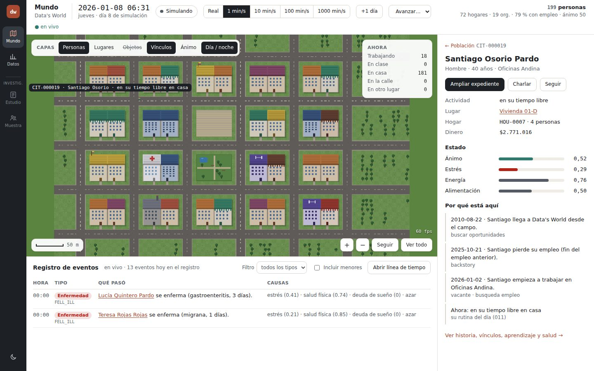 | 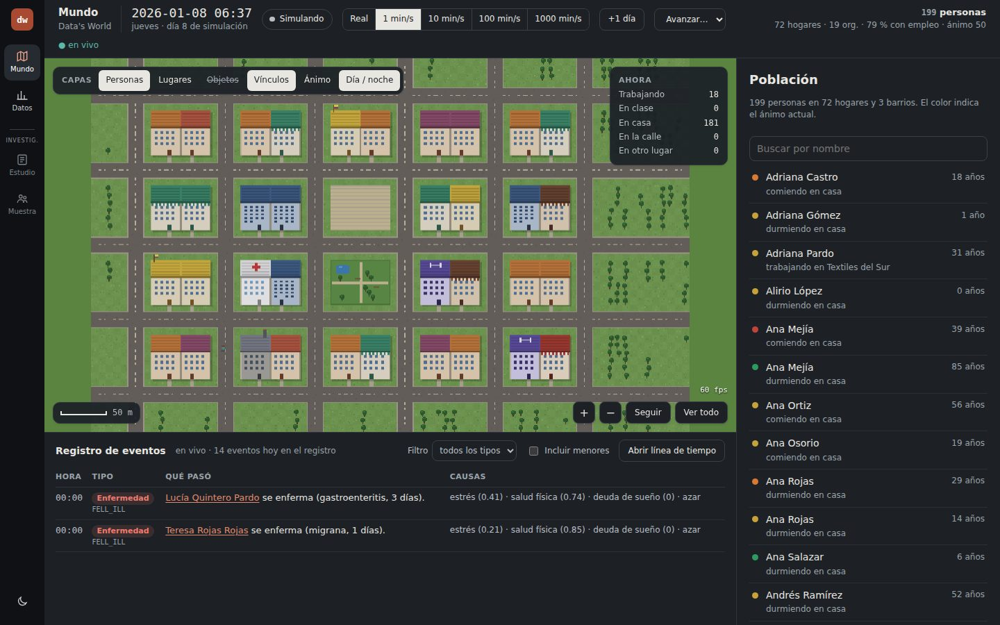 |

| Expediente · Resumen | Expediente · Estado y necesidades |
|---|---|
| 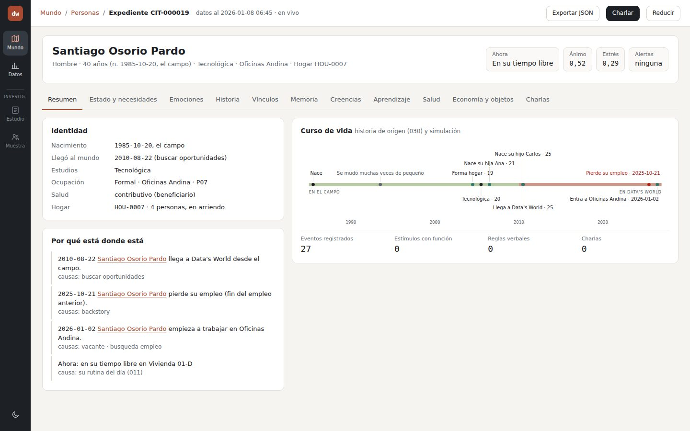 | 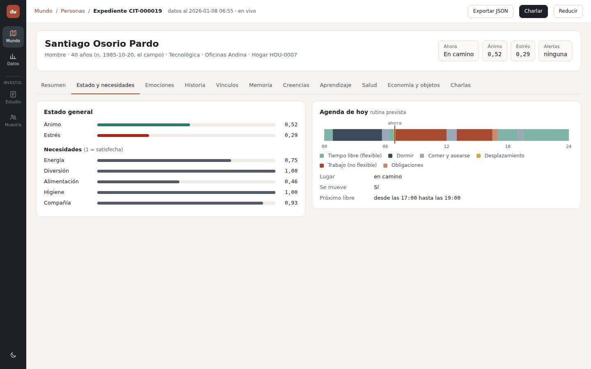 |

| Expediente · Historia | Expediente · Vínculos |
|---|---|
| 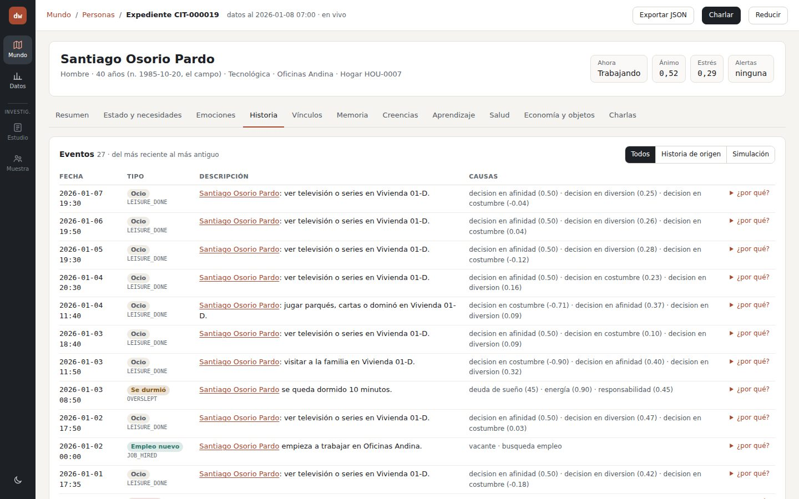 | 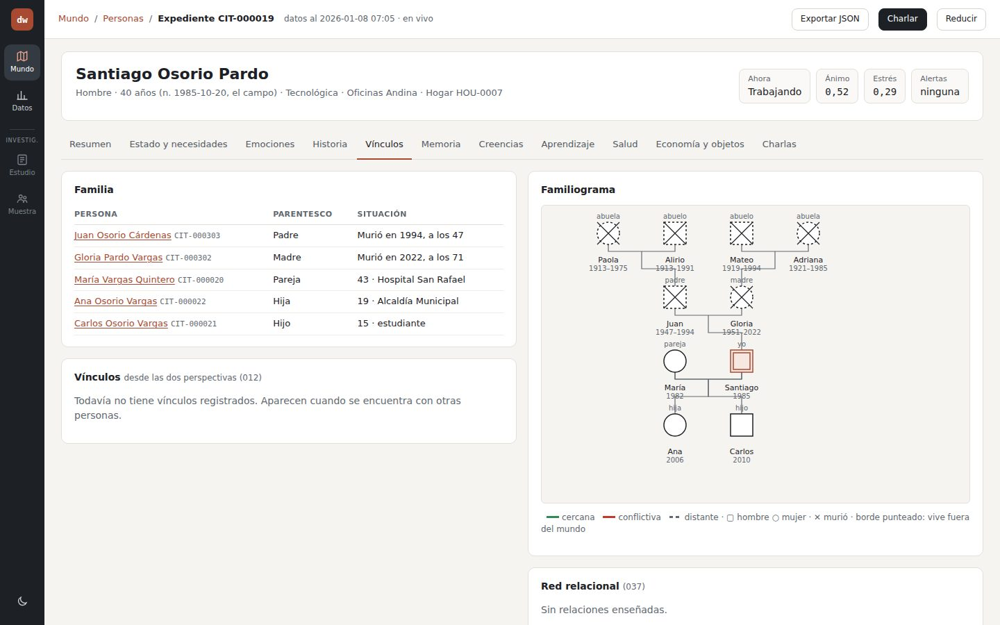 |

| Expediente · Aprendizaje | Expediente · Economía y objetos |
|---|---|
| 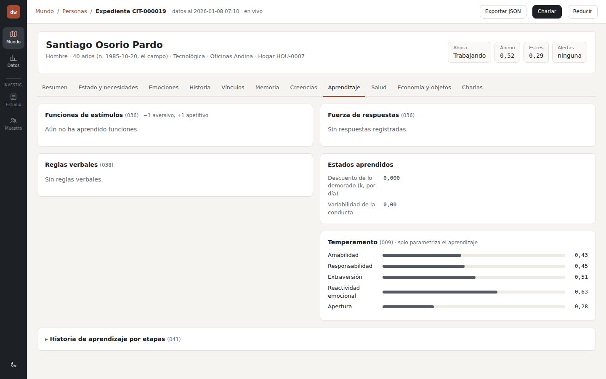 | 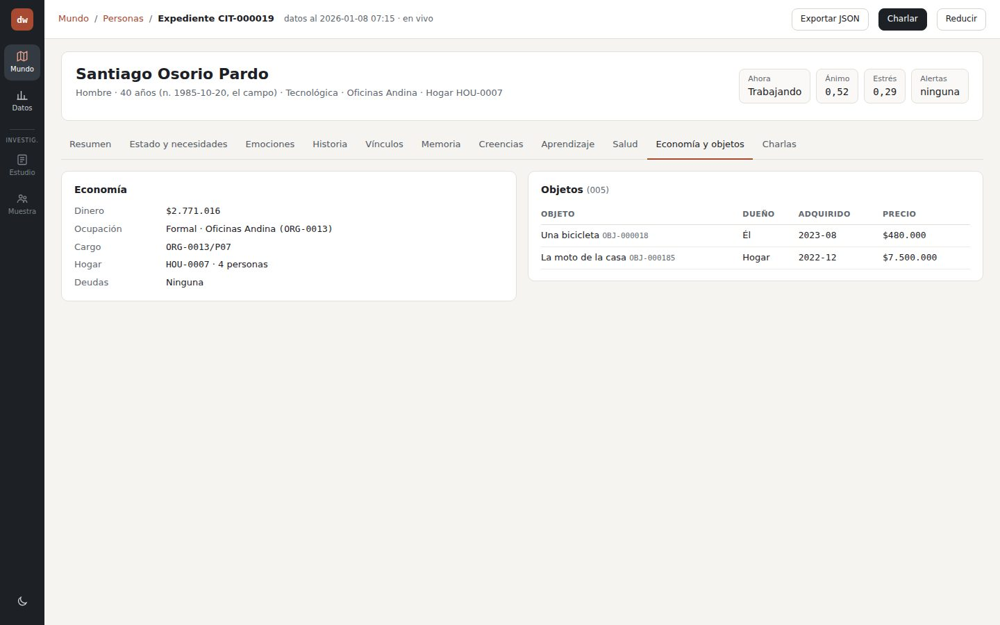 |

| Dashboard | Charla (sandbox, modo prueba) |
|---|---|
| 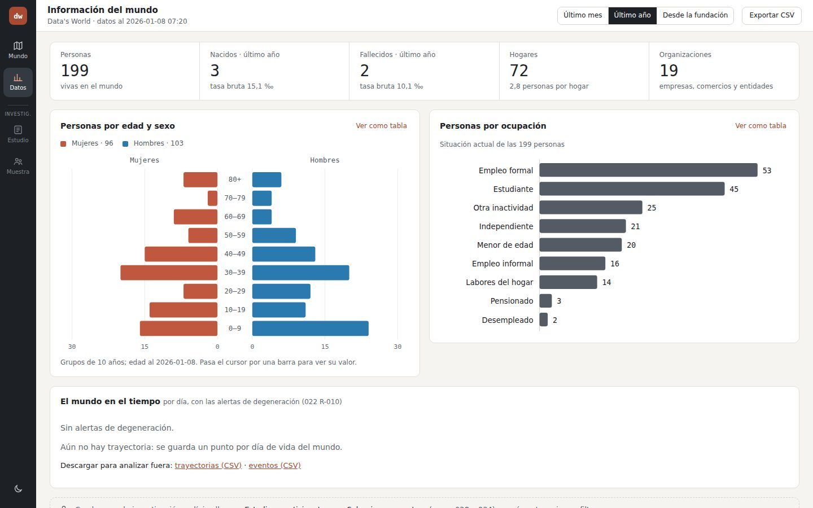 | 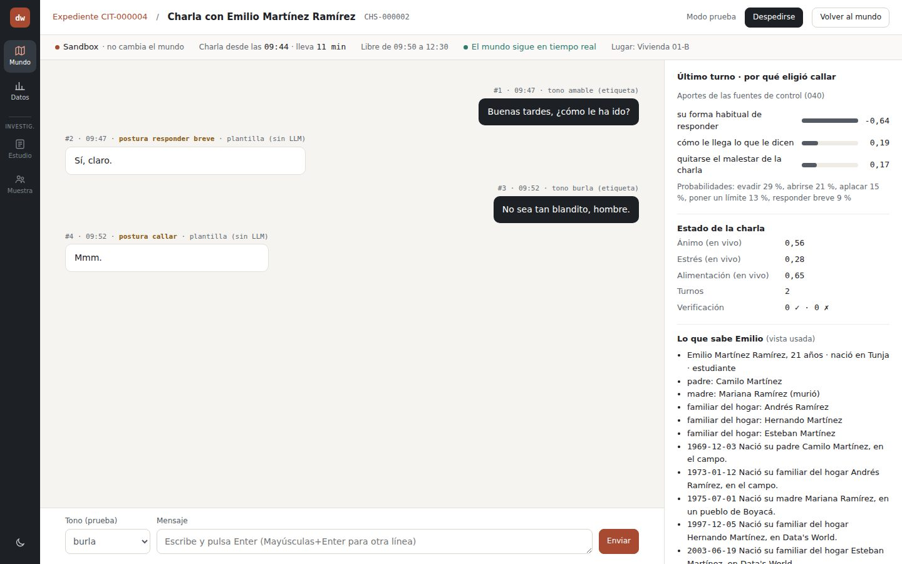 |

| Resumen al despedirse | Móvil (375 px) |
|---|---|
| 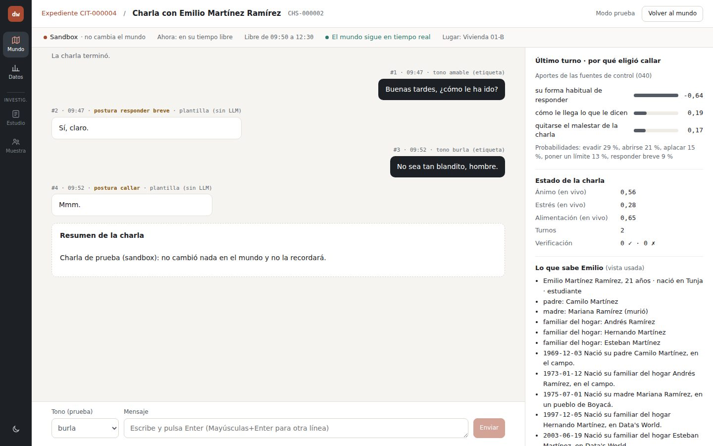 | 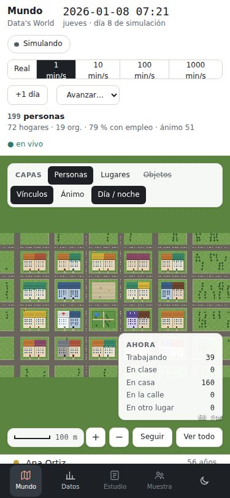 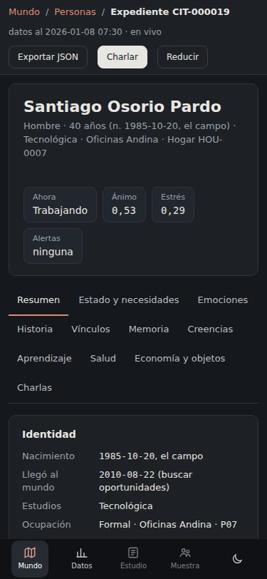 |

## Pruebas

- `apps/api/src/dossier.test.ts`: 022 CA-012 (expediente), CA-013 (demografía) y 024 CA-016 (cada persona en una sola categoría de «Ahora»).
- `apps/web/src/exp.test.ts`: 024 CA-014 (cada pestaña del expediente), CA-015 (pirámide, ocupación, periodo y «Ver como tabla»), CA-016 (capas, «Ahora» y escala) y las direcciones de las pantallas.
- Prueba de punta a punta en Chromium: abrir cada pantalla, cambiar de pestaña, empezar una charla en sandbox con modo prueba, enviar dos mensajes con tono etiquetado y despedirse.

## Pendiente

- **Revisión del usuario (024 CA-017).**
- Exponer en la API de la charla el valor del visitante y el malestar acumulado, que dibuja el lienzo (043).
