# M4 — Visor Data's World: capturas frente al lienzo

Fecha: 2026-10-05 · Rama `m4/visor-datas-world` · Spec 024 v0.7 (la v0.6 la aprobó el usuario el 2026-10-05) · Criterio **CA-021** (revisión visual; sustituye a la CA-017).

Referencia: el tablero `T10` del lienzo «Datas World — Mesa de análisis, 10 arenas» (https://claude.ai/artifact/5FCJEBnX28Ky4CHsPdP39t), con sus cuatro ventanas. Las capturas del visor son del mundo `data/world.db` (199 personas, 2027-03-02), en Chrome sin ventana a 1440 × 900. Las del lienzo, del mismo tamaño.

## Mundo

| Lienzo | Visor |
|---|---|
| 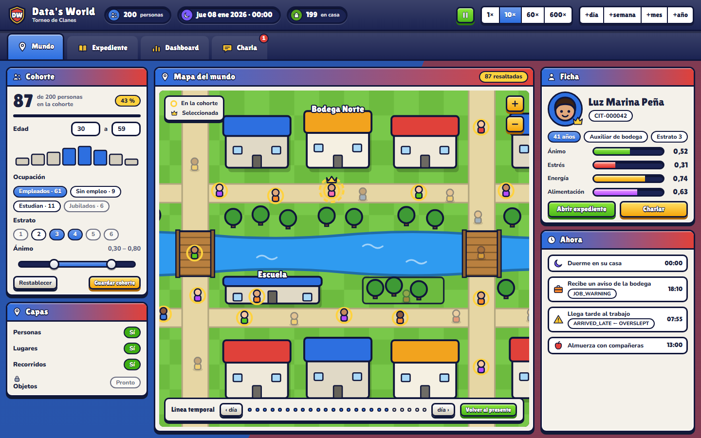 | 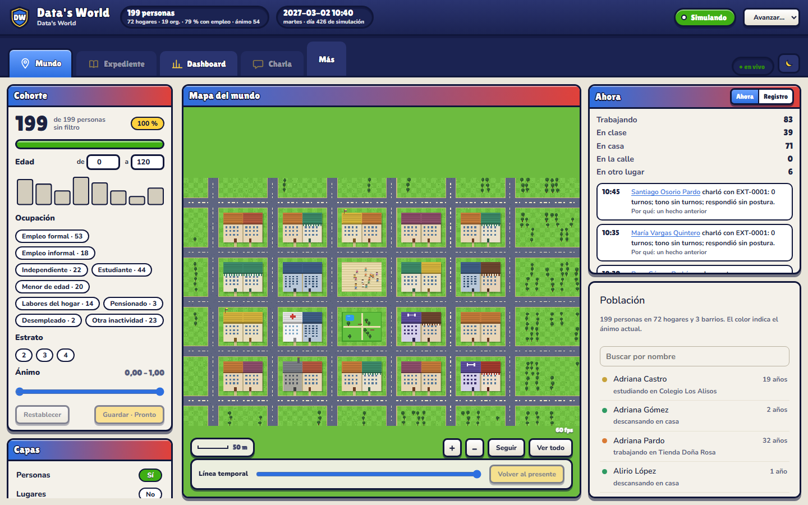 |

Con una cohorte activa (empleo formal, estrato 3, desde los 30 años: 18 personas, 9 %), quien está en ella lleva un aro dorado y el resto se atenúa:

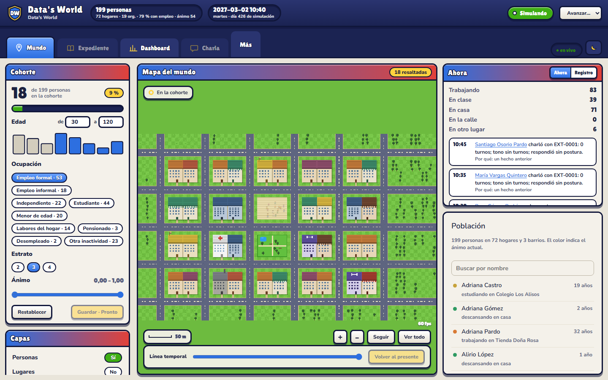

| Lienzo | Visor | Diferencia |
|---|---|---|
| Barra superior con la marca, tres fichas de recurso y los controles de tiempo | Igual, sin selector de velocidades y con un menú «Avanzar» (1 día a 1 año) | Decisión del usuario (2026-10-05) |
| Pestañas Mundo, Expediente, Dashboard y Charla | Igual, más el menú «Más» con Estudio y Muestra bloqueados | Expediente y Charla se abren con la última persona elegida |
| Cohorte: tamaño, edad con histograma, ocupación, estrato, ánimo | Igual; la ocupación y el estrato salen de `/api/citizens` (022 R-017) | «Guardar» desactivado con «Pronto» (decisión del usuario) |
| Capas con interruptores Sí/No | Igual; Objetos bloqueado (aún no tienen posición en el mapa) | — |
| Mapa con leyenda, zoom y línea temporal | Igual, con «Seguir», «Ver todo» y la escala | El mapa pixel art se recolorea con la paleta del estilo |
| Ficha compacta y «Ahora» con eventos | «Ahora» (conteos y últimos eventos con sus causas) y «Registro» (la tabla completa) en pestañas; debajo, la ficha o la población | La ficha compacta aparece al elegir a una persona |

## Expediente

| Lienzo | Visor |
|---|---|
| 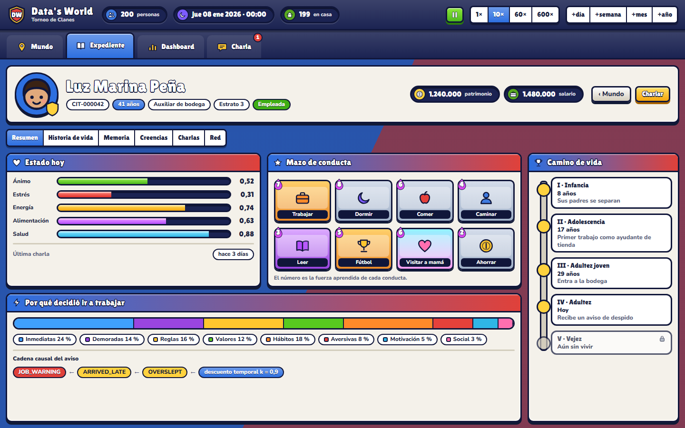 | 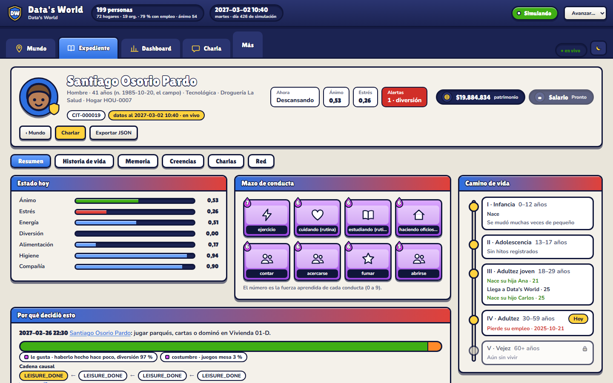 |

| Lienzo | Visor | Diferencia |
|---|---|---|
| Encabezado con retrato, edad, ocupación, patrimonio y salario | Igual; el salario aparece bloqueado con «Pronto» (la API no lo expone) | — |
| Seis pestañas: Resumen, Historia de vida, Memoria, Creencias, Charlas y Red | Igual (decisión del usuario); las direcciones de las once pestañas anteriores llevan a la nueva que las reúne | — |
| Estado hoy, Mazo de conducta, Por qué decidió esto y Camino de vida | Igual; el mazo son las ocho conductas con más fuerza aprendida y la barra de fuentes sale de las causas del último evento de decisión | Las fuentes son las reales del motor (le gusta, costumbre, una regla…), no las ocho del lienzo |
| — | Debajo del Resumen: identidad, curso de vida, y «Estado y necesidades» y «Aprendizaje» plegados | Conserva lo que ya existía |

## Dashboard

| Lienzo | Visor |
|---|---|
| 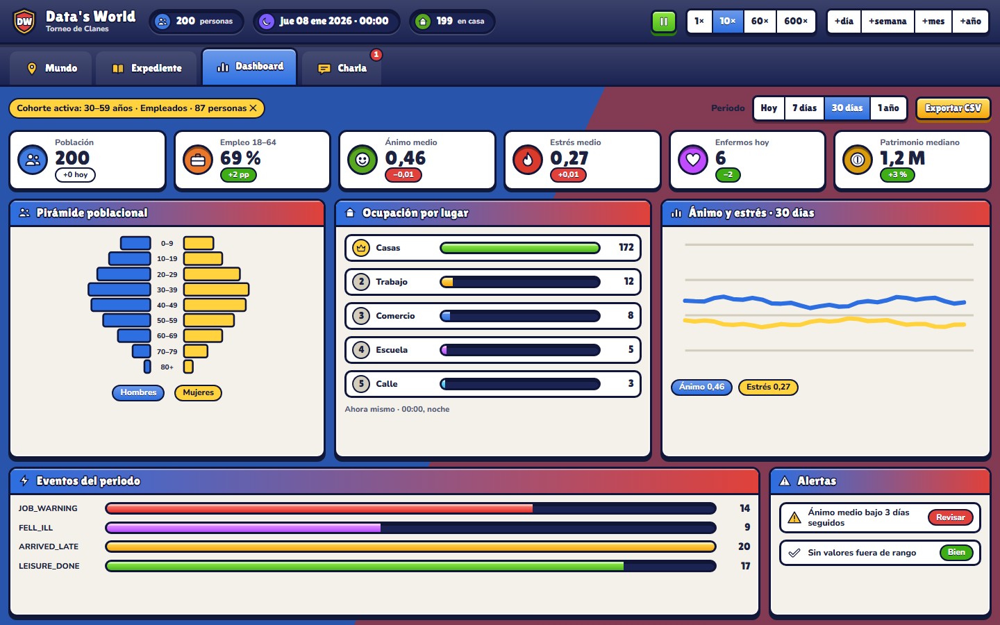 | 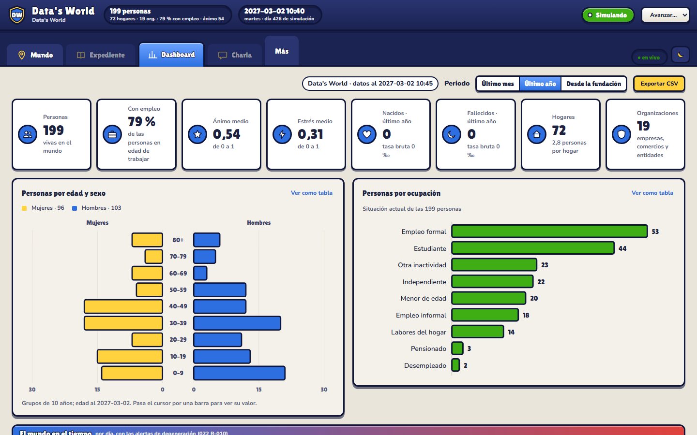 |

| Lienzo | Visor | Diferencia |
|---|---|---|
| Cohorte activa con «✕», periodo y Exportar CSV | Igual; la cohorte solo resalta el mapa, las cifras son de toda la población | Periodos de la API: último mes, último año y desde la fundación (022 R-016) |
| Seis indicadores | Personas, con empleo, ánimo medio, estrés medio, nacidos, fallecidos, hogares y organizaciones | «Enfermos hoy» y «patrimonio mediano» no se muestran: la API no los expone |
| Pirámide, ocupación por lugar, serie de ánimo y estrés, eventos y alertas | Pirámide, personas por ocupación y, debajo, las series y las alertas del panel del mundo | La ocupación por tipo de lugar queda como ocupación laboral (022 R-016) |

## Charla

| Lienzo | Visor |
|---|---|
| 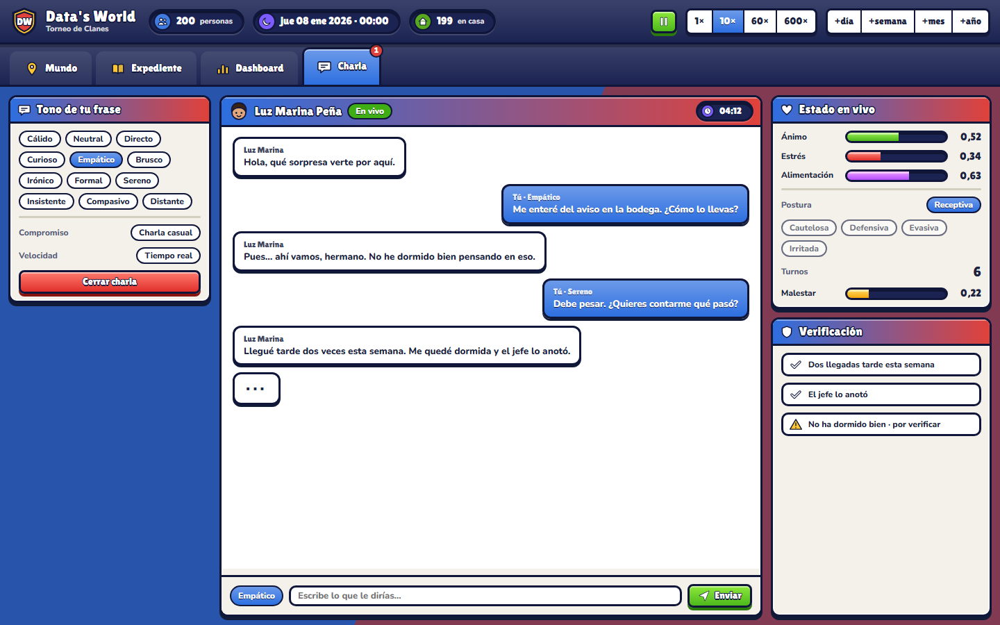 | 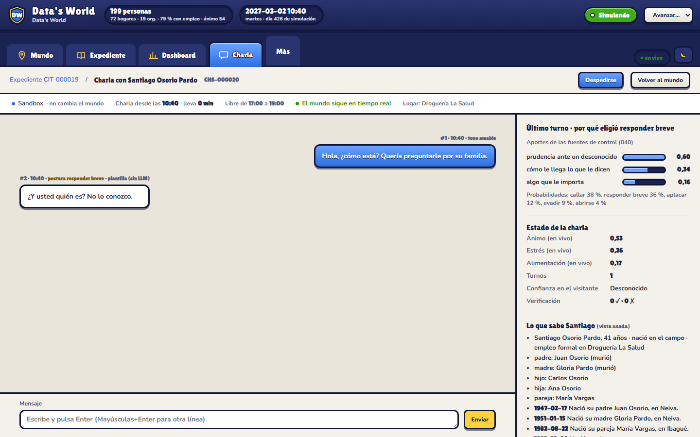 |

La captura del visor muestra la prudencia ante un desconocido (043 v0.7): ante un primer mensaje de un extraño, la persona responde «¿Y usted quién es? No lo conozco.» (sin LLM, plantilla), la confianza dice «Desconocido» y el porqué de la respuesta incluye la fuente «prudencia ante un desconocido».

| Lienzo | Visor | Diferencia |
|---|---|---|
| Columna con el tono de la frase (12 tonos) | No se porta: el tono lo clasifica el sistema, salvo en modo prueba (selector en el formulario) | — |
| Burbujas, estado en vivo y verificación | Burbujas con número, hora, tono y postura; estado en vivo con «Confianza en el visitante»; verificación y lo que sabe la persona | La vista completa de lo que sabe no cambia; lo que cuenta depende de la confianza |

## Estado

- Criterios con prueba automática: CA-018 a CA-020 y CA-022 verdes (`apps/web`).
- **CA-021: pendiente de la aceptación del usuario** frente a estas capturas.
- Fuera de esta entrega: el modo oscuro afinado (decisión del usuario: tras aceptar la CA-021).

## Mapa en el estilo del lienzo (024 v0.8, R-030, CA-023)

Revisión pedida por el usuario el 2026-10-05 («el diseño del mapa del mundo… en eso sí está diferente»). Mismo mundo (`data/world.db`, 2027-03-02) y mismo tamaño de pantalla.

| Visor (antes) | Visor (después, zoom de apertura ×1,9) |
|---|---|
|  | 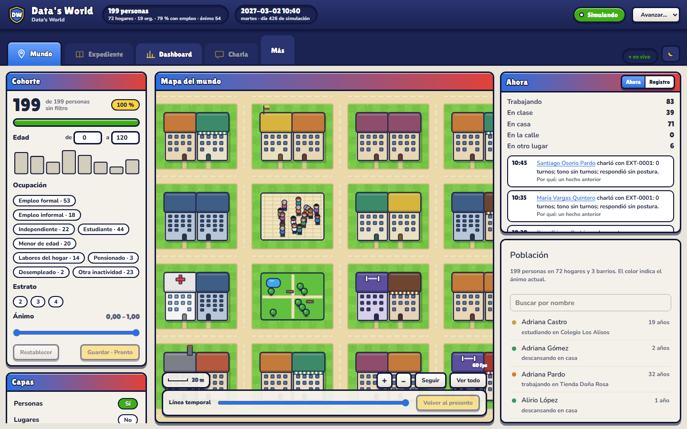 |

Con acercamiento, comparable al tablero del lienzo:

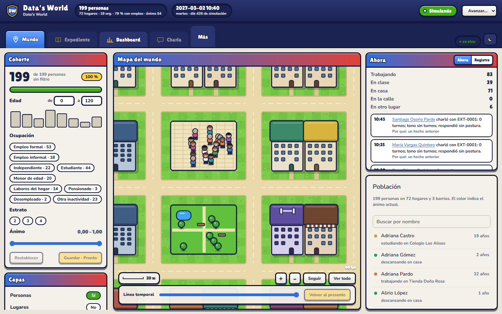

| Lienzo | Visor | Diferencia |
|---|---|---|
| Calles beige con línea discontinua, césped en damero brillante | Igual | — |
| Edificios grandes con tejado de color y contorno grueso | Igual; los colores de cada tipo siguen siendo los del prototipo (`styleOf`) | — |
| Figuras grandes con aro dorado para la cohorte | Figuras «chibi» con ropa variada (`lookOf`), aro con halo y el ánimo en un punto junto a la cabeza | Decisión del usuario: el ánimo va en un punto, no en toda la figura |
| Río con puentes | No está | El mundo no tiene agua (cambiaría la geografía, spec 003) |
| Zoom cercano | Abre en ×1,9; «Ver todo» muestra el mapa entero | — |

- **CA-023:** prueba automática de `layerScale` verde. La revisión visual queda **pendiente de la aceptación del usuario** frente a estas capturas.
